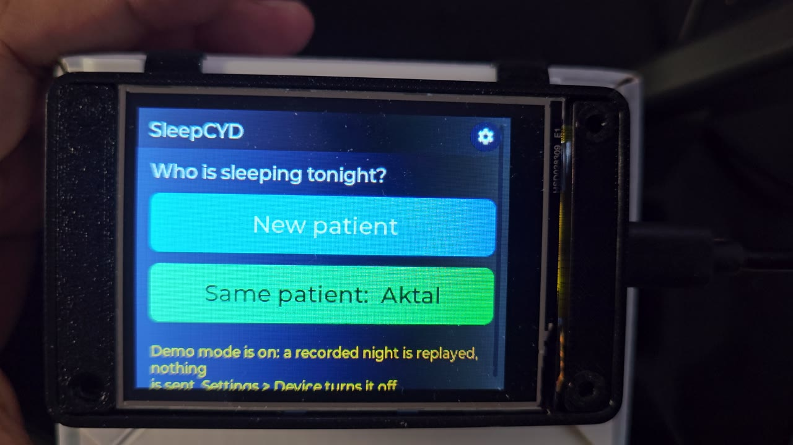
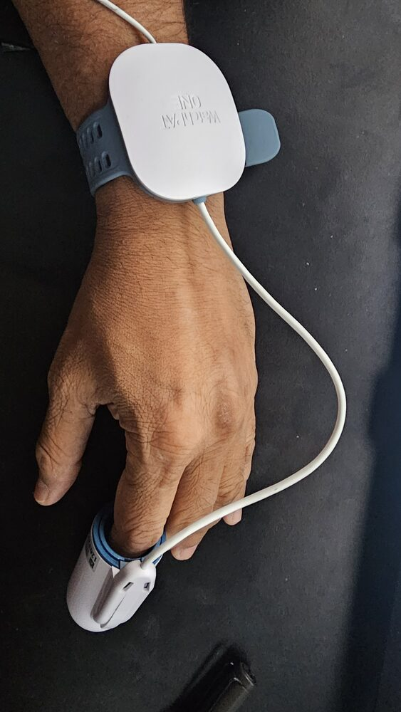
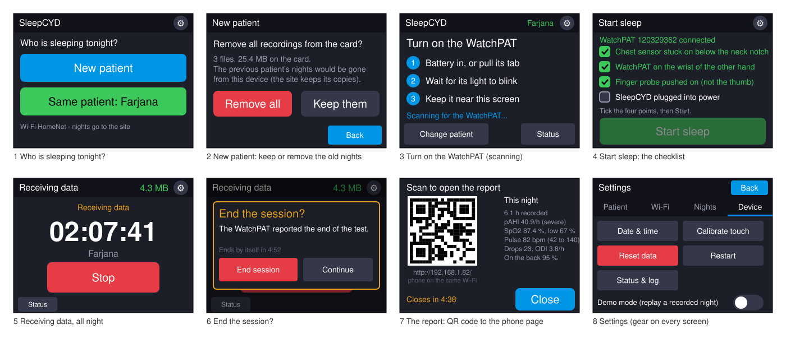
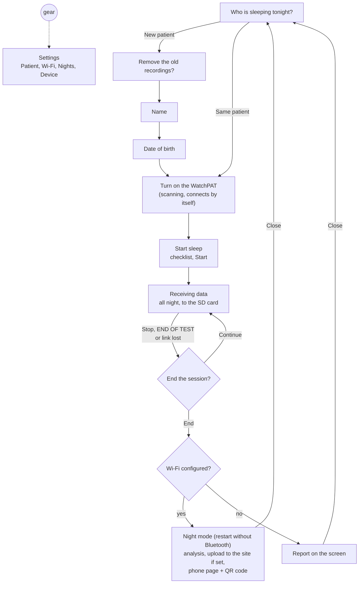
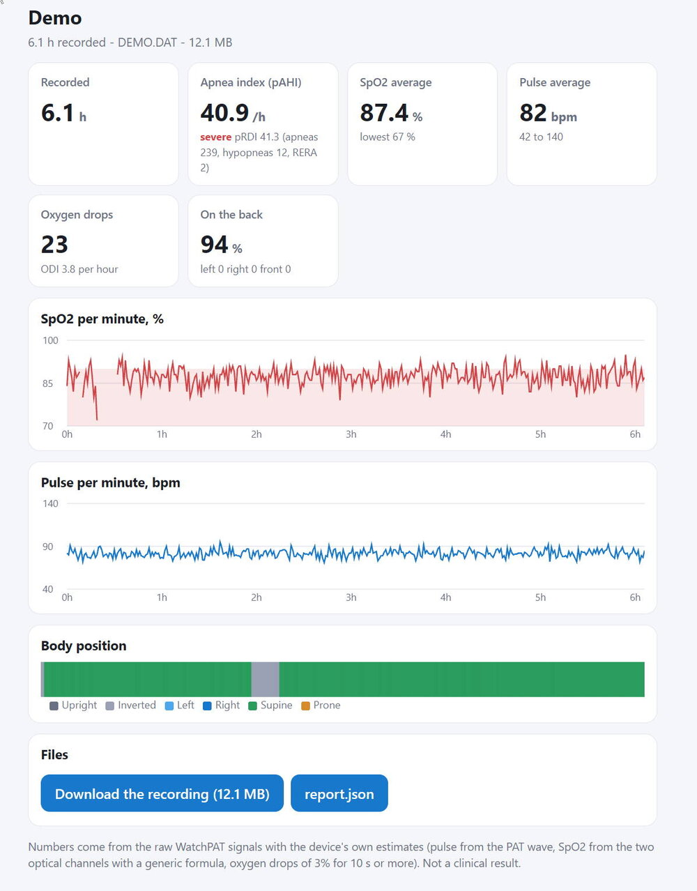

# SleepCYD: Pocket Sleep Analyzer for WatchPAT ONE

SleepCYD turns a 10-dollar touch-screen board, the **Cheap Yellow Display** (ESP32-2432S028), into a bedside recorder
for the **WatchPAT ONE** home sleep test sensor. The board finds the sensor over Bluetooth LE, stores the whole night on a
microSD card, analyses it in the morning and shows the result three ways: on its own screen, on your phone through a QR
code (a web page served on your home Wi-Fi), and, if you run one, on a Nidra site where the night is uploaded by itself.

No PC, no phone app, no cloud account. The person puts the sensor on, answers a few prompts on the touch screen, sleeps,
and reads the report over breakfast.

> SleepCYD is not a medical device and is published for experiments and personal curiosity. The numbers it computes
> (SpO2, pulse, oxygen drops, pAHI...) are estimates from the raw signals with simple rules; they are not the
> manufacturer's scoring and must not be used for diagnosis or treatment decisions. If you worry about your sleep, see a
> doctor.

## See it in action

A 1 minute 22 second walkthrough on the real board in demo mode: choosing the patient, entering a name on the touch
keyboard, the checklist, and the report. Click the picture to play the video ([MP4, 720p](docs/videos/sleepcyd-demo.mp4)).

## Why this project exists

The WatchPAT ONE is sold as a **single-use** sensor. You wear it for one night, the official phone app uploads the
recording to the vendor's cloud, and from then on the app refuses to work with that unit. The hardware, though, is still
fine: the wrist unit, the finger probe, the chest sensor and most of the battery are all there.

We found that the sensor still powers up, still advertises over Bluetooth and still streams a complete night of data
when it is asked the right way. SleepCYD asks it the right way. With it, a sensor that would go in the bin can record
again, and its owner can get an idea of their sleep: oxygen levels, pulse, oxygen drops, breathing pauses, time on the
back.

Keep two things in mind. The battery is sized for one night, so a reused unit may not last a full second night, and the
sensor's behaviour after the vendor's session has been closed is not documented anywhere. Treat every reused night as an
experiment, and do not use it to replace a test your doctor ordered.

## Why a Cheap Yellow Display

The ESP32-2432S028 is an ESP32 with a 2.8" colour touch screen, a microSD slot and Wi-Fi plus Bluetooth on one board,
for about the price of a cable. For this job it has exactly what is needed and nothing more:

- **Very low cost.** The whole recorder is the board, a microSD card and a USB charger.
- **Little power.** It runs all night from any phone charger, drawing under a watt with the screen on.
- **The data stays with you.** The night is written to the SD card as it arrives, 2 MB per hour, so nothing is lost if
  the Wi-Fi is down, and nothing leaves the house unless you configure an upload. You can take the card to a PC any time.
- **A screen and a touch panel** are enough to guide a person through the setup, show the sensor is connected and show
  the result, without a phone or a computer.
- **It is well known.** The CYD has a large community, documented pin-outs and many firmware projects to learn from.

The price of all that is memory: the ESP32 has 320 KB of RAM and no PSRAM, and Bluetooth, Wi-Fi and the screen do not
fit at the same time. That is why the firmware has separate boot modes for recording and for reporting
([docs/architecture.md](docs/architecture.md)).

## Functional requirements

What SleepCYD has to do, and does:

1. **Record a whole night.** Connect to a WatchPAT ONE, start its session, acknowledge every packet and store all
   channels (two oximetry wavelengths, PAT, chest, metric, motion) losslessly on the card for 8 hours or more.
2. **Guide a non-technical person.** Ask who is sleeping, collect the name and date of birth once, say when to switch
   the sensor on, give the checklist for wearing it, and show plainly that data is coming in.
3. **Survive the night.** Keep recording when the Bluetooth link drops and comes back, end cleanly when the sensor
   reports the end of its test, and keep what was recorded if the person stops early.
4. **Report without a PC.** Analyse the recording on the board itself and show the headline numbers on the screen.
5. **Report on a phone.** Serve a page with the numbers and the per-minute charts on the home network, reachable by
   scanning a QR code on the screen, with the raw recording available for download.
6. **Upload when wanted.** Send the night to a Nidra site automatically when a URL and a token are configured, and
   never when they are not.
7. **Be configured on the screen.** Patient, Wi-Fi network and password, date and time, touch calibration and demo
   mode all have screens; the serial console is for the technician.
8. **Replay a night for demonstration.** A recorded night on the card can be played through the whole report flow
   without a sensor.
9. **Run in 320 KB of RAM** with a 4 MB flash, on stock libraries, built with arduino-cli.

## Built on other people's work

SleepCYD would not exist without the people who opened up the WatchPAT ONE before us.

- **[dakahler/watchpat](https://github.com/dakahler/watchpat)**, the *WatchPAT ONE BLE Client*: the reverse-engineered
  Bluetooth protocol, the packet format, the channel decoding and the live dashboard in Python. SleepCYD's `watchpat.h`
  is a port of that protocol, and the analysis rules in `analysis.h` follow its `watchpat_analysis.py`. If you want to
  look at a recording on a PC, start there; `sleep_report.py` in this repo uses its analysis module.
- **[Nidra to n8n](https://github.com/opensourcera)**, our companion server: an n8n workflow and a Postgres store that
  receive the nights from the phone app or from SleepCYD and build the full reports. SleepCYD's `nidra.h` is a client of
  its ingest API.
- The **LVGL**, **TFT_eSPI** and **NimBLE-Arduino** projects, and the ESP32 Arduino core, which make a firmware like
  this a few thousand lines instead of a few hundred thousand.

If you build something on top of this, or have a sensor whose behaviour differs from what is written here, open an
issue: every reused unit teaches something.

## What you need

- A Cheap Yellow Display: ESP32-2432S028, 2.8" ILI9341 320x240 with XPT2046 touch, microSD slot, 4 MB flash, no PSRAM.
- A microSD card (FAT32; the firmware formats a blank card itself). A night is about 2 MB per hour.
- A WatchPAT ONE (Itamar / ZOLL), new or already used once with the official app. The unit is activated by inserting
  its battery or pulling the tab, and then advertises as `ITAMAR_<serial in hex>`.
- Optional: a 2.4 GHz Wi-Fi network for the phone page and the uploads, and a Nidra site to receive the nights.

This is how the WatchPAT ONE is worn: the unit on the wrist of the non-dominant hand, like a watch, and the finger probe
pushed onto a finger (any finger but the thumb). The third part, the chest sensor, is not in the picture: it is the cable
leaving the top of the unit, and its patch sticks on the skin just below the notch at the base of the neck, where it
picks up snoring, breathing effort and body position. The checklist on the Start screen walks through these three
points plus the charger for SleepCYD itself.

 

## How a night goes

1. **Who is sleeping tonight?** "New patient" or "Same patient: <name>". A gear in the top right corner of every screen
   opens Settings.
2. New patient: an offer to remove the previous recordings from the card, then the name keyboard, then the date of birth.
3. **Turn on the WatchPAT.** Scanning starts here. The sensor is connected as soon as it is found (or by itself after 30 s).
4. **Start sleep.** The sensor's serial number and a four-point checklist in the words of the WatchPAT patient guide: chest
   sensor stuck on below the neck notch, WatchPAT on the wrist of the other hand, finger probe pushed on (not the thumb),
   SleepCYD plugged into power. Start lights up when all four are ticked; it also asks for the date when the clock is unknown.
5. **Receiving data.** Elapsed time, the patient's name, megabytes saved, a status line, and Stop.
6. **End the session?** From Stop, from the sensor's own END OF TEST (ends by itself after 5 minutes), or when the link has
   been lost (10 minutes, the recording so far is kept; a reconnection closes the prompt).
7. **The report.** With Wi-Fi configured the board restarts into *night mode*: the recording is analysed (about 90 s for a
   6 h night), uploaded to the Nidra site when one is configured, and served on the home network as a phone-friendly page
   with a QR code on the screen (`http://<ip>/`, also `http://sleepcyd.local/`). A summary of the night is shown beside the
   QR code. The page stays up 5 minutes, 3 minutes after the last request, then the board goes back to being a recorder.
   Without Wi-Fi the report is shown on the device's screen and saved on the card.

Settings has four tabs. **Patient**: name, date of birth, New patient. **Wi-Fi**: the network and the site; "Change the
Wi-Fi network" restarts the board without Bluetooth, lists the networks, takes the password on a full keyboard, tests the
connection and saves. **Nights**: the last recordings on the card, each opening its report page again; "Send the last
night". **Device**: date and time, touch calibration, Reset data (removes the recordings after a second tap), Restart,
Status & log (the technical screen: state, counters, live log, device list, manual Scan and Disconnect), and the
**Demo mode** switch.

### Demo mode

With the switch on, the patient screen leads straight to the checklist and Start replays a recorded night from
`/DEMO.DAT` at the root of the card: analysis, phone page, QR code, nothing sent, patient named "Demo". Without that file a
synthetic hour is played instead. To put a night on the card, copy any recording to the card root as `DEMO.DAT`, or without
removing the card: serve the file from a PC (`python -m http.server 8098` in its folder), restart the board into the Wi-Fi
setup boot (serial `i`) and send `g http://<pc ip>:8098/<file>`; it downloads at about 500 KB/s.

## The report

Three forms of the same analysis (`analysis.h`, streamed packet by packet, the same code live and in night mode):

- **On the device**: hours recorded, SpO2 average and lowest, pulse, oxygen drops and ODI, pAHI with its severity, pRDI,
  time on the back.
- **On the phone** (`webpage.h`, reads `/report.json` from the device): cards for the apnea index, SpO2, pulse, oxygen
  drops, position and breathing; SpO2 and pulse per minute; the position timeline; download of the recording.
- **On the Nidra site**: the raw recording is uploaded and the site builds its own report; the device shows a second QR
  code pointing at it.

The page above is what the phone shows after scanning the QR code: it comes straight from the web server inside the
board, no internet involved. This one is the demo night: 6.1 hours, pAHI 40.9 (severe), SpO2 average 87.4 % with a low
of 67 %, 23 oxygen drops, 94 % of the night on the back, and the recording itself one tap away.

The apnea index follows the PAT method in a simplified form: an event starts when the PAT amplitude falls to 70 % of its
baseline and ends when it recovers; the oxygen drop and the pulse rise during the event make it an apnea, a hypopnea or a
RERA. pAHI = (apneas + hypopneas) per hour, severity normal < 5, mild < 15, moderate < 30, severe above. The rules, the
JSON fields and the file formats are in [docs/data-and-reports.md](docs/data-and-reports.md).

## Build

Toolchain: [arduino-cli](https://arduino.github.io/arduino-cli/) with the ESP32 core 3.3.x, and these libraries in the
Arduino libraries folder:

| Library | Version | Configuration |
|---|---|---|
| lvgl | 9.3.0 | copy `config/lv_conf.h` next to the `lvgl` folder (QR code, canvas, keyboard, tabview, checkbox, switch, Montserrat 12-28 and 48) |
| TFT_eSPI | 2.5.43 | copy `config/TFT_eSPI_User_Setup.h` over the library's `User_Setup.h` (ILI9341 on HSPI, CYD pins) |
| NimBLE-Arduino | 2.3.6 | none |
| CydLauncher | bundled in `lib/` | passed with `--library` |

The touch controller is bit-banged on GPIO 25/39/32/33 because VSPI drives the SD card and HSPI the display.
`partitions.csv` gives the firmware one 3.75 MB app slot (the QR code, canvas and the large font do not fit the stock layout).

From the repository folder:

    arduino-cli compile --fqbn "esp32:esp32:esp32:PartitionScheme=custom,FlashSize=4M,DebugLevel=error" --library lib/CydLauncher --build-path build .
    python tools/flash.py COM5 all      # first time: bootloader, partition table, boot record and the firmware
    python tools/flash.py COM5          # later: the firmware only

The serial console runs at 115200. `?` lists the commands.

## Configuration

Everything lives in the ESP32's NVS and survives reflashing. The screen sets the patient, the Wi-Fi network, the clock,
the touch calibration and demo mode. The serial console sets the rest:

| Command | Effect |
|---|---|
| `wSSID,password` | Wi-Fi network (Settings > Wi-Fi does the same on screen) |
| `uhttps://host/webhook/nidra` | the Nidra ingest URL; nights are uploaded automatically when it is set |
| `tTOKEN` | the Nidra token (`X-Nidra-Token` header) |
| `y<tz>` | POSIX time zone for the file names, e.g. `EST5EDT,M3.2.0,M11.1.0` (default US Eastern) |
| `nName`, `oYYYY-MM-DD` | patient name, date of birth |
| `Ty,m,d,h,m,s` | set the clock by hand (NTP sets it whenever Wi-Fi is up) |
| `Wname` | substring of the advertised name to connect to (default `ITAMAR`) |

Diagnostics: `M` status and counters, `L` list the card, `R <file>` dump a file, `d <file>` delete, `F` format the card,
`v <file>` open a night's report page, `q <file>` send a night to the site, `k` run the demo night, `J` the synthetic night,
`i` restart into Wi-Fi setup, `g <url>` download `DEMO.DAT`, `P x,y` inject a touch, `H` calibrate, `Z` touch probe,
`b` forget the Bluetooth pairing, `x` forget the remembered sensor, `K` ask the sensor for its technical status, `G`/`E`
start/end a session, `O` switch to another firmware slot when one is present.

The upload uses TLS without certificate verification; the token is the only protection. Keep the token private.

## PC tools

- `sleep_report.py night.dat --start "2026-10-15 22:40" --name "Name"` builds a self-contained HTML report (tabs: summary,
  oxygen, pulse and breathing, apnea, sleep and position, events) plus a JSON file from a recording. It replays the
  recording through the analysis module of the WatchPAT ONE BLE client project (`watchpat_analysis.py`, folder given by the
  `WATCHPAT_DIR` environment variable), so its numbers come from that project, not from the firmware.
- `samples/watchpat_s0017.dat` is a short capture from this firmware; `samples/example_night_report.html` a report built
  from a 6-hour night.

## Repository

    SleepCYD.ino        the sketch: display, touch, SD, Bluetooth, screens, serial, night mode, Wi-Fi setup
    analysis.h          streaming analysis of the WatchPAT channels
    watchpat.h          the WatchPAT ONE protocol over the Nordic UART Service
    nidra.h             the Nidra upload client
    webpage.h           the phone page
    records.h           the BLE record handed to the SD writer
    partitions.csv      flash layout (one 3.75 MB app partition)
    config/             lv_conf.h and the TFT_eSPI User_Setup used for the release
    lib/CydLauncher     boot splash and firmware ID (header-only library)
    tools/flash.py      esptool wrapper
    sleep_report.py     PC report from a recording
    docs/               architecture, data formats and report fields, development log

More: [docs/architecture.md](docs/architecture.md), [docs/data-and-reports.md](docs/data-and-reports.md),
[docs/devlog.md](docs/devlog.md), [CHANGELOG.md](CHANGELOG.md).

WatchPAT is a trademark of Itamar Medical / ZOLL. This project is not affiliated with them; the protocol was learned by
observing the phone app's traffic and is used only to store what the sensor sends.
